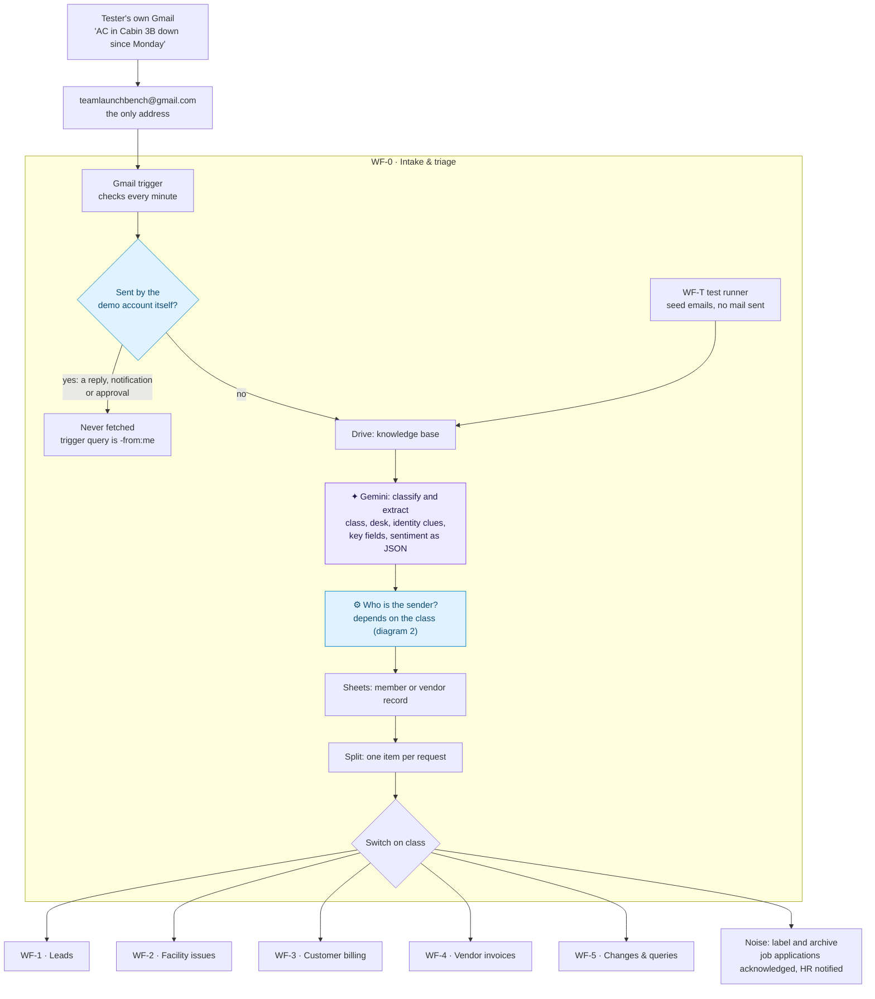
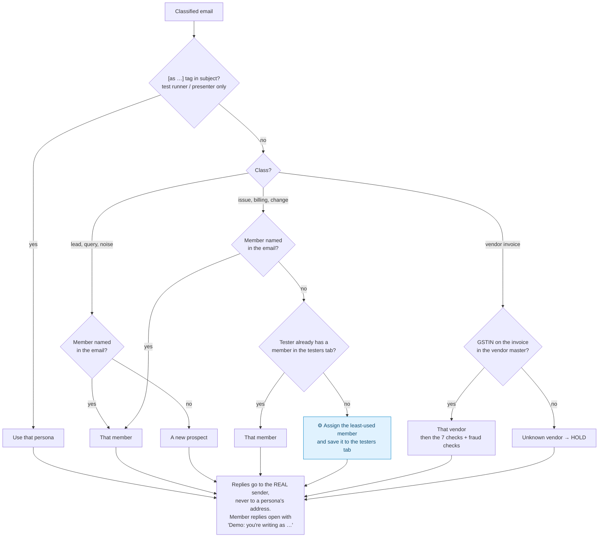
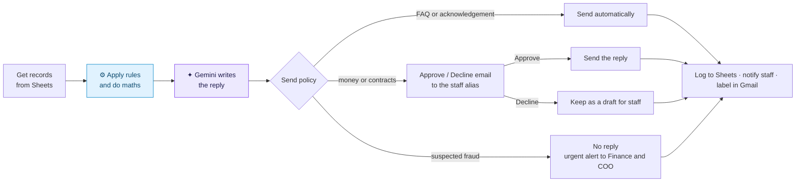
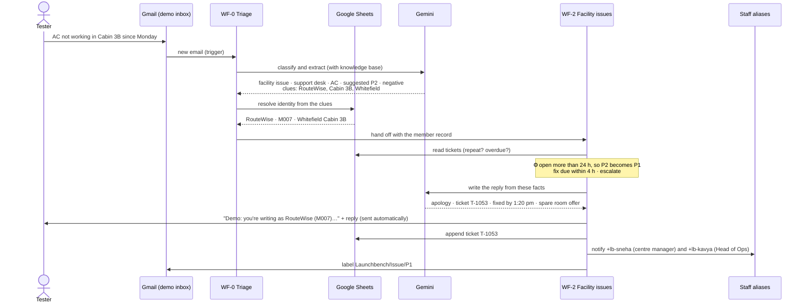
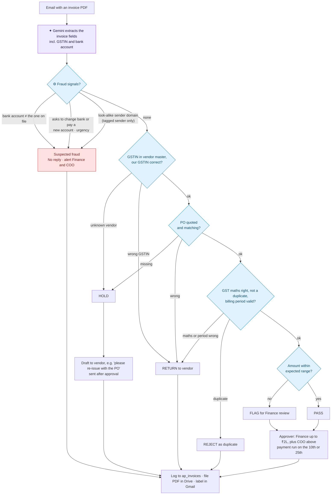
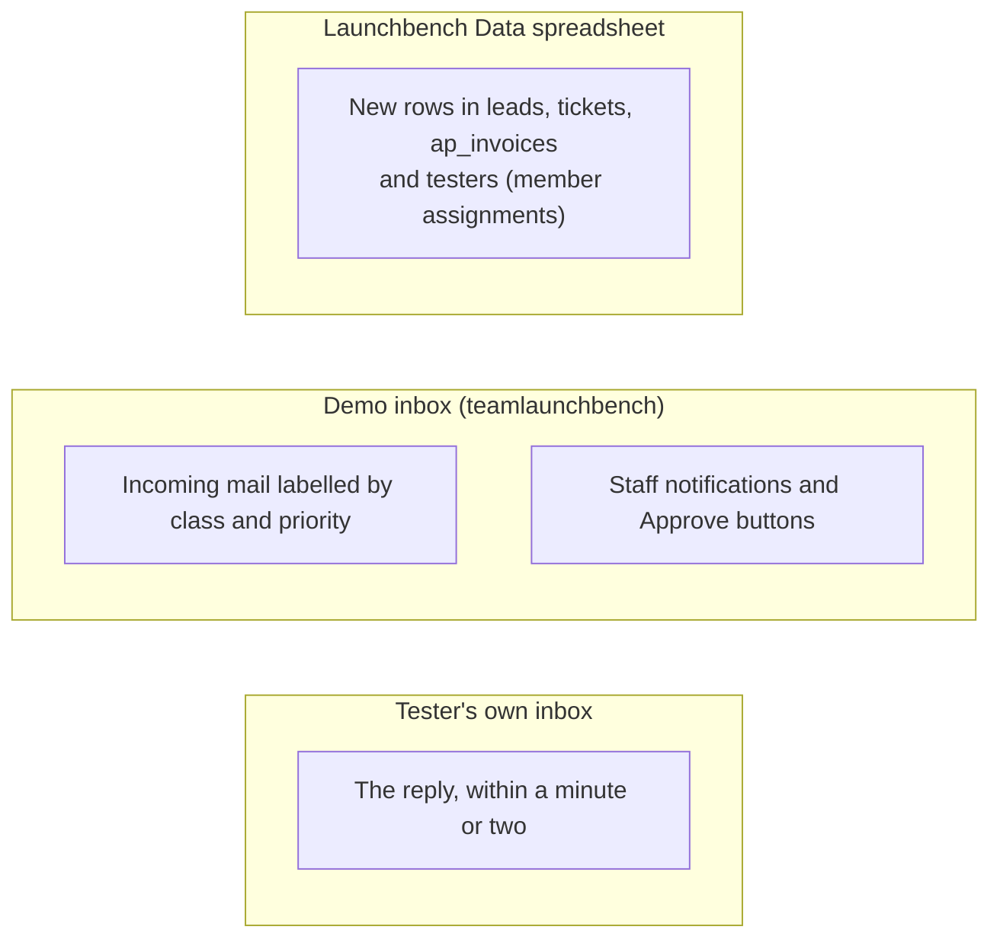

# Launchbench Email Automation: Diagrams

These are companion diagrams to [workflow-design.md](workflow-design.md).
- **Legend:** ✦ = AI step (Gemini). ⚙ = plain code (rules and arithmetic, no AI).
- **Viewing:** GitHub renders these diagrams. VS Code needs the *Markdown Preview Mermaid Support* extension.

## 1. The big picture
There is one address and one main workflow (WF-0). It reads every incoming email, works out what it is and who sent it, then hands it to one of five specialist workflows.

There are two more workflows that sit outside this flow:
- **WF-E (errors):** if any step fails, it emails `+lb-ops` and labels the message, so nothing disappears silently.
- **WF-T (test runner):** a button that passes the chosen seed emails straight into WF-0, each with its `[as <alias>]` tag and scripted date, so every run gives the same results without sending any mail.

## 2. Who is the sender? (identity, demo mode)
Testers write from their own Gmail, so the workflow can't match them by email domain. Instead, the class decides what kind of sender to look for. Replies always go back to the real person.

With `demo_mode` off, every branch above becomes "match by sender domain", and an unknown member gets "we couldn't find your account".

## 3. Inside every specialist: the same five steps
The design rule is this: **code decides and calculates, Gemini only writes the words.** Every number in a reply can therefore be checked against the spreadsheet.

| Workflow | ⚙ Code works out | ✦ Gemini writes | Sent how |
|---|---|---|---|
| WF-1 Leads | Which cabins fit; the price at each lock-in length; the deposit; hot, warm or cold | A reply with the options and a tour invitation | Acknowledgement automatically; the quote after approval |
| WF-2 Facility issues | Priority P1–P4 (raised if repeated or overdue); deadlines in clock time | Acknowledgement with ticket, deadline, workaround | Automatically |
| WF-3 Customer billing | Whether the customer's claim matches the invoice, usage and exit records | An explanation from the checked facts, with no promised waivers | After approval |
| WF-4 Vendor invoices | The 7 vendor checks and fraud signals; the payment-run date | The invoice fields extracted from the PDF; a request for a missing PO | HOLD after approval; fraud never |
| WF-5 Changes & queries | Exit date, deposit refund date, the fee difference when downsizing | A knowledge-base answer, or a change confirmation | Queries automatically; changes after approval |

## 4. One email from start to finish
A tester, with no tag and no instructions, sends *"AC not working in Cabin 3B since Monday, we're RouteWise at Whitefield"*:

Had the tester not named a company, they would have been assigned a member, and the same flow runs against that member's cabin and tickets.

## 5. Vendor invoices: checks and outcomes
This specialist relies most heavily on rules. Gemini only reads the PDF. Every decision after that is code. Fraud checks run first and override everything else.

Three ways to see the fraud path:

| How | Seed | What catches it |
|---|---|---|
| Forward the Guardian Shield PDF from the Test Kit | 28 | Bank account ends 8851; the vendor master says 3356. Every other check passes. |
| Improvise a "we've changed banks, pay urgently" email | 21 is the scripted version | The bank-change request and the urgency in the text |
| Presenter sends seed 21 with `[as sparkleserv-fake]` | 21 | The look-alike domain `sparkleserv-billing.in` |

## 6. What a viewer sees during the demo

